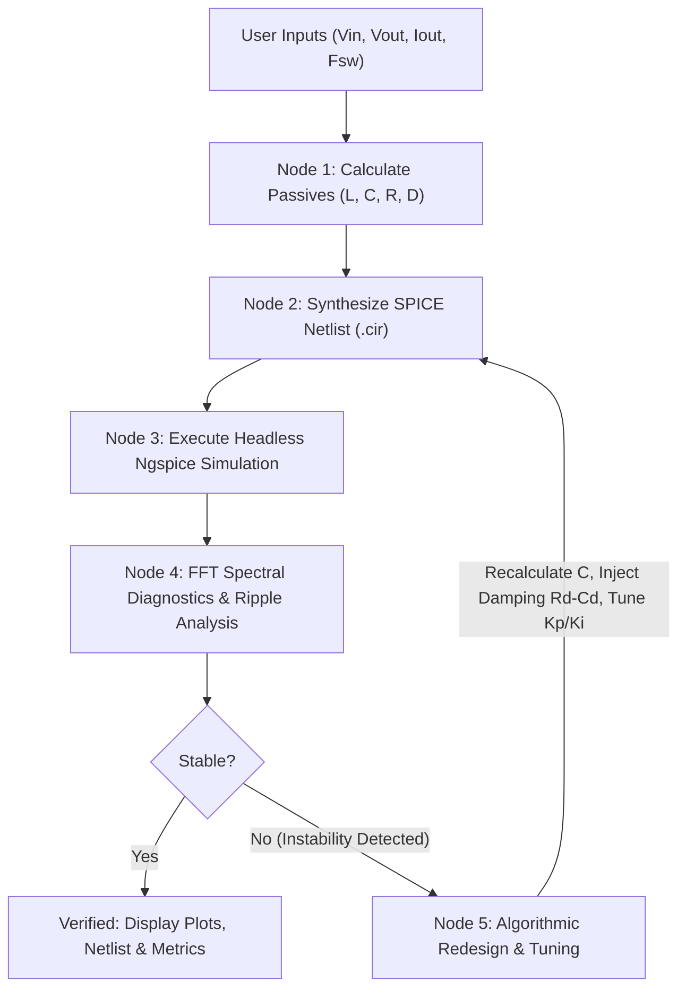

# Autonomous Power Converter Design & Simulation Studio

An Agentic AI system for autonomous synthesis, simulation, and algorithmic verification of switch-mode power electronic converters using **LangGraph**, **Streamlit**, and **Ngspice**.

---

## Overview

Unlike generic chatbots that produce unverified SPICE text, this tool is a **dedicated design-cum-simulation interface** for power electronics engineers:
1. **Interactive Design Interface**: Allows selecting converter topologies (Buck, Boost, SEPIC, Cuk, FSBB, LLC), defining operating specifications ($V_{\text{in}}, V_{\text{out}}, I_{\text{out}}, f_{\text{sw}}$), and running automated simulations.
2. **Deterministic Physics Engine**: Calculates passive component values ($L, C, R, D$) based on volt-second balance, charge balance, and Continuous Conduction Mode (CCM) boundary constraints.
3. **Headless Ngspice Simulation**: Automatically synthesizes `.param`-driven SPICE netlists and executes batch simulations.
4. **Dual-Domain FFT Diagnostics**: Analyzes steady-state output signals in both time and frequency domains to isolate:
   - High-frequency switching ripple vs. filter capacitance.
   - Mid-frequency LC filter tank resonance vs. loop crossover.
   - Low-frequency integrator hunting / PI windup.
5. **Two-Tier Closed-Loop Correction**:
   - **Tier 1 (Control Level)**: Auto-tunes $K_p, K_i$ controller gains.
   - **Tier 2 (Power Stage Level)**: Algorithmically recalculates $L, C$ and injects Middlebrook $R_d - C_d$ damping networks if physical resonance is detected.
6. **Live Parameter Tweaking**: Enables manual adjustment of $L, C, R, K_p, K_i$ via interactive sliders and instant re-simulation.

---

## Prerequisites

1. **Ngspice**: Must be installed on your machine and accessible in your system `PATH` (e.g. typing `ngspice --version` in terminal returns the version).
2. **Python 3.10+**: Used to run the application, LangGraph workflow, and scientific diagnostics.

---

## Installation & Setup

1. **Clone this repository**:
   ```bash
   git clone <repository-url>
   cd <repository-folder>
   ```

2. **Install Python dependencies**:
   ```bash
   pip install -r requirements.txt
   ```
   *(Installs: `streamlit`, `langgraph`, `langchain-core`, `scipy`, `numpy`, `matplotlib`)*

---

## How to Run the Custom Interface

Launch the dedicated web interface by running:

```bash
streamlit run app.py
```

Your default web browser will automatically open the dashboard at `http://localhost:8501`.

### Using the Interface:
1. **Select Converter Topology**: Choose from Buck, Boost, SEPIC, Cuk, or Four-Switch Buck-Boost from the sidebar.
2. **Enter Specifications**: Input $V_{\text{in}}$, target $V_{\text{out}}$, load current $I_{\text{out}}$, switching frequency $f_{\text{sw}}$, and allowed ripple percentage.
3. **Click "⚡ Synthesize & Verify Circuit"**:
   - The LangGraph state machine calculates passive components.
   - Generates the parameterized SPICE netlist.
   - Executes Ngspice batch simulation.
   - Computes FFT diagnostics and evaluates stability.
   - If unstable, automatically triggers the closed-loop redesign engine.
4. **Inspect Waveforms & FFT Diagnostics**:
   - View the dual-panel time-domain waveform and frequency-domain FFT spectrum.
   - Check regulation metrics (Average Voltage, Peak-to-Peak Ripple, Dominant Frequency).
5. **Tweak Parameters (Optional)**:
   - Switch to the **Parameter Tuning & Tweaking** tab to adjust $L_1, C_{\text{out}}, R_{\text{load}}, K_p, K_i$.
   - Click **"🔄 Re-Simulate with Tweaked Parameters"** to observe instantaneous waveform and stability changes.
6. **Download Netlist**:
   - Switch to the **Verified SPICE Netlist** tab to inspect syntax and download the `.cir` file.

---

## Agentic Workflow Architecture (LangGraph)

The design and verification loop is governed by an explicit StateGraph in `automation/agent_graph.py`:



---

## Repository Structure

```
├── app.py                      # Main Streamlit Graphical User Interface
├── automation/
│   ├── agent_graph.py          # LangGraph StateGraph agentic workflow
│   ├── circuit_solver.py       # Deterministic RLC sizing & Middlebrook damping solver
│   ├── fft_diagnostics.py      # FFT frequency-domain decomposition & ripple analyzer
│   ├── spice_optimizer.py      # PI controller grid-search auto-tuner
│   └── ac_analysis.py          # Bode plot phase margin stability evaluator
├── Circuit Library/            # Parameterized SPICE reference templates (Buck, Boost, SEPIC, LLC, etc.)
├── outputs/                    # Verified .cir netlists and diagnostic plots
├── Instructions.txt            # Engineering methodology and design rules
├── project_research_report.pdf # Comprehensive research report and theoretical derivations
├── requirements.txt            # Python dependencies
└── README.md                   # Project documentation and user guide
```

---

## Technical Documentation

For detailed theoretical derivations, mathematical models, and the four evolutionary phases of the project, refer to:
📄 **[`project_research_report.pdf`](project_research_report.pdf)** included in the root directory.
